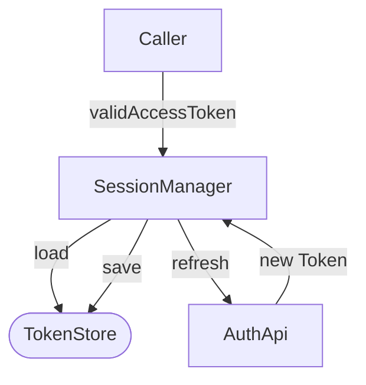
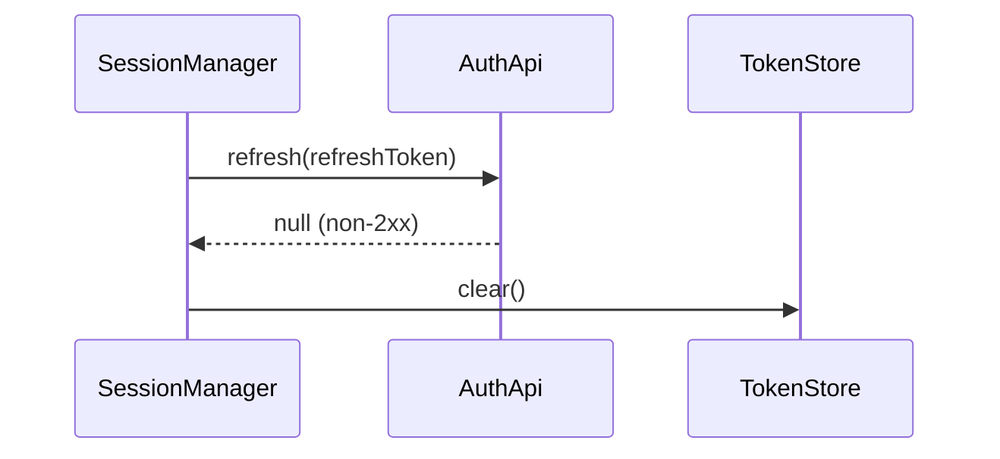

# Session and token handling in sample-app

## Summary

Access tokens are refreshed 5 minutes before expiry using a robust, seamless mechanism. A failed refresh logs the user out after one attempt, not three. Tokens are stored as Base64, not encrypted. This document records the behavior as the code implements it and lists the gaps against the README.

## Requirements

| ID | Requirement | Target |
|---|---|---|
| FR-1 | Return a valid access token or null | `validAccessToken` never returns an expired token |
| NFR-1 | Tokens at rest are encrypted | AES-256 per README; not met, see Security |

## Current state

`SessionManager` hands out the stored access token while the clock is earlier than expiry minus the refresh window. Past that point it calls the refresh endpoint. Figure 1 shows the request path. **Verified** at `src/auth/SessionManager.kt:13-190`.

*Figure 1. Token retrieval path*



The refresh window and retry count are constants in the class. **Verified**, `src/auth/SessionManager.kt:10-11`:

```kotlin
    private val refreshWindowMillis = 2 * 60 * 1000L
    private val maxRetries = 3
```

> **Warning:** The README states a 5-minute window and 3 retries. The code uses 2 minutes and 1 attempt. The code is the source of truth; this document follows it. Satisfies FR-1 only when the refresh call succeeds.

## Failure path

When the single refresh attempt returns null, `refresh` calls `logout()` and returns null. **Verified**, `src/auth/SessionManager.kt:21-31`:

```kotlin
    private fun refresh(token: Token): String? {
        repeat(maxRetries) {
            val result = api.refresh(token.refresh)
            if (result != null) {
                store.save(result)
                return result.access
            }
        }
        logout()
        return null
    }
```

Figure 2 shows the same failure as a sequence.

*Figure 2. Refresh failure leads to logout*



## Security

`TokenStore.encryptToken` only Base64-encodes its input, so NFR-1 is not met. **Verified**, `src/auth/TokenStore.kt:25-26`:

```kotlin
    private fun encryptToken(value: String): String =
        Base64.encodeToString(value.toByteArray(), Base64.NO_WRAP)
```

TBD

## Open questions

- Is the 2-minute window intentional, or did the README's 5 minutes reflect a later decision? Owner: Platform team. Blocks: any change to NFR-1 or FR-1 targets.
- Where is the keystore-backed implementation the README implies? **Assumption:** it was planned and not built.
